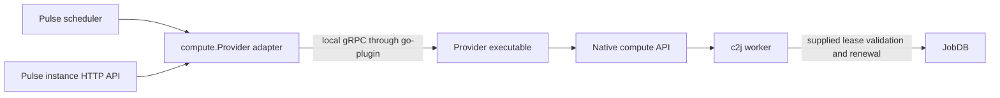

# Proposal for instance provider plugins using HashiCorp go-plugin

Status: proposed, updated 2026-10-27. Baselines: Pulse `0bdeda6`, Gitvend `9bf948927f3e73ac791ebb0c94f614badaabf8c4`, and Gitvend's JobDB SDK dependency `f403447cb58a`. Configuration, package names, and RPCs below are proposed APIs.

Add a `plugin` provider type that launches an operator-configured executable and exposes it through the existing `compute.Provider` interface. Use HashiCorp `go-plugin` with gRPC and a public Pulse SDK. Keep both process settings and provider-specific settings in Pulse's existing YAML configuration, under `providers.<name>.plugin`. Pulse passes each plugin only its own configuration during initialization. This lets teams ship new compute backends independently of the Pulse binary while keeping placement, lease ownership, and active-instance inspection consistent with existing providers.

The critical rule is unchanged: **a failed submission RPC may have launched work**. A plugin crash, timeout, or lost response must produce an uncertain outcome, never an automatic retry or an unjustified fallback. Restarting a plugin restores service for future calls; it does not replay old launches.

## Scope and existing integration points

Here, an instance provider means the compute backend that submits launches and lists active instances. Gitvend's existing JobDB secret-provider plugin runs alongside JobDB and has a different protocol and trust boundary. Use its implementation as the integration precedent; the earlier local [secret-provider feature request](docs/feature-requests/jobdb-secret-provider-go-plugin.md) is historical design context.

Pulse already has the right extension interface in [pkg/compute](pkg/compute/compute.go):

```go
type Provider interface {
    Submit(context.Context, []Launch) ([]Submission, error)
    List(context.Context, ListRequest) (ListResponse, error)
}
```

The implementation fits into these existing boundaries:

| Existing component | Proposed integration |
| --- | --- |
| [Configuration](internal/config/config.go) | Recognize `type: plugin` and validate a nested plugin block. |
| [Provider construction](internal/providers/providers.go) | Construct a managed RPC adapter and register its cleanup function. |
| [Scheduler](internal/scheduler/scheduler.go) | Continue using `compute.Provider`, priority tiers, and existing per-item fallback rules. |
| [Public instance API](internal/httpapi/http.go) | Include plugin providers through the existing `List` interface. |
| [Public configuration](internal/config/public.go) | Explicitly redact plugin configuration and arguments. |
| [CLI lifecycle](cmd/pulse/main.go) | Start plugins for `check`, `run --once`, and continuous operation; clean them up on every exit path. |

Keep Docker, cloud, and HTTP remote providers available. No built-in provider extraction is required for the first release. Keep the existing [remote provider protocol](REMOTE_PROVIDER_PROTOCOL.md) for independently operated services across machines. HashiCorp describes go-plugin as a local subprocess/RPC system and explicitly excludes unreliable remote-network operation. [HashiCorp project documentation](https://github.com/hashicorp/go-plugin)

The first release includes submission, listing, configuration, protocol negotiation, process management, and a conformance suite. Capacity discovery, instance termination, completion callbacks, host callbacks, automatic plugin downloads, hot reload, and process reattachment are outside this scope.

## Consistency with Gitvend

Gitvend's `jobdb-gitvend-secret-provider` loads its issuer YAML, initializes its provider, and calls JobDB's public `secretplugin.Serve(p)`. Its executable integration test starts that same binary using `Start(ctx, ProcessConfig{Command: binary, Args: []string{"--config", configPath}})` and closes the returned process. Follow that division of ownership: the host controls execution and the plugin owns its configuration schema. [Gitvend CLI](https://github.com/colony-2/gitvend/blob/9bf948927f3e73ac791ebb0c94f614badaabf8c4/cmd/jobdb-gitvend-secret-provider/internal/cmd/root.go), [executable integration test](https://github.com/colony-2/gitvend/blob/9bf948927f3e73ac791ebb0c94f614badaabf8c4/pkg/jobdbprovider/plugin_test.go)

| Convention | Pulse proposal |
| --- | --- |
| Host process configuration | Use `command`, `args`, `pass_env`, `sha256`, `start_timeout`, and `max_concurrent`, matching the JobDB SDK's Go field names in snake case. Keep Pulse's named provider map and routing. |
| Public SDK | Keep `Start(ctx, ProcessConfig)`, process-setting `ValidateConfig`, and a `Process` with `Close()`. Adapt `Serve` to accept a provider factory initialized through RPC from Pulse's configuration. |
| Wire transport | Use versioned gRPC plugin sets, `NetRPCUnsupportedPlugin`, generated protobuf types, and adapters around the domain interface. |
| Process isolation | Use explicit environment forwarding, local automatic mTLS, optional executable SHA-256 verification, bounded calls, and no RPC retry policy. |
| Provider CLI | Retain `version` and `--help`. Use Pulse's existing `check --config pulse.yaml` to validate configured providers. |
| YAML loading | Keep strict typed validation and a 1 MiB limit per provider configuration block. Resolve referenced files using the source directory supplied by Pulse. |

These conventions are grounded in Gitvend's pinned [JobDB serving adapter](https://github.com/colony-2/jobdb/blob/f403447cb58a/pkg/jobdb/secrets/plugin/plugin.go), [process host](https://github.com/colony-2/jobdb/blob/f403447cb58a/pkg/jobdb/secrets/plugin/process.go), [YAML decoder](https://github.com/colony-2/gitvend/blob/9bf948927f3e73ac791ebb0c94f614badaabf8c4/internal/configutil/config.go), and [provider loader](https://github.com/colony-2/gitvend/blob/9bf948927f3e73ac791ebb0c94f614badaabf8c4/pkg/jobdbprovider/config.go).

Configuration delivery deliberately differs from Gitvend: Pulse already has a provider registry in its YAML, so provider settings belong there too. The plugin owns the schema, while Pulse owns loading and delivering its configuration. No separate provider configuration file or plugin `--config` argument is required.

Keep Pulse's handshake cookie, dispensed interface, protobuf namespace, and domain errors separate. A Gitvend secret-provider executable must fail the Pulse handshake. In particular, JobDB maps transport loss to secret unavailability; a compute submission that may have started must become `unknown`. Reuse conventions and focused infrastructure helpers where their contracts match, without importing Gitvend internals or adapting compute launches through JobDB's secret interface.

Gitvend also watches configuration/key files and atomically replaces valid snapshots. Pulse v1 deliberately uses startup-loaded provider configuration: changing a compute scope or admission budget can affect ownership of already accepted work, so live reload needs its own design. The proposed bounded restart budget and compute-specific readiness/cleanup RPCs below are also Pulse policies, not claims about Gitvend's existing behavior. [Gitvend configuration reload behavior](https://github.com/colony-2/gitvend/blob/9bf948927f3e73ac791ebb0c94f614badaabf8c4/docs/jobdb-secret-provider.md#configuration-reloads-and-key-rotation)

## Architecture and SDK



Run one persistent process per configured provider name. Two names using the same executable still represent separate configurations and processes. Reuse a provider name across targets when they share an admission domain. A plugin managing local capacity must prevent overlapping ownership or coordinate it through its backend; separate processes do not create separate physical capacity.

Introduce these packages and artifacts:

| Location | Responsibility |
| --- | --- |
| `proto/providerplugin/v1/provider.proto` | Versioned protobuf contract, following the JobDB source layout. |
| `pkg/providerplugin/proto/v1` | Generated Go messages and gRPC service definitions. |
| `pkg/providerplugin` | Handshake constants, conversions/validation, adapters, `Serve`, `Start`, `ProcessConfig`, and owned process lifecycle. |
| `internal/providers/plugin` | Mapping Pulse configuration to SDK options and integrating host diagnostics. |
| `pkg/providerplugin/plugintest` | Reusable provider conformance tests. |
| `examples/provider-plugin` | A separately built reference executable and sample configuration. |

Keep `pkg/compute` independent of go-plugin and generated protobuf types. Initially publish the SDK within Pulse's existing module; plugin authors pin a Pulse release and import only public packages. The RPC protocol, rather than identical source revisions or Go toolchains, defines binary compatibility. A separate SDK module can follow if dependency or release cadence warrants it.

The proposed `Serve(factory Factory, options ...ServeOptions)` registers a provider factory. On `Configure`, the SDK gives the factory an initialization context, the provider's YAML bytes, and an absolute base directory for file references. The factory strictly decodes its schema and initializes a `compute.Provider`; the SDK admits business RPCs only after success. Options carry implementation identity, transport limits, and an optional shutdown hook. Offer a small public strict-YAML decoder/path-resolution helper for authors. This factory is the necessary adaptation of Gitvend/JobDB's preinitialized `Serve(provider)` model. External authors should not need to import `internal/config`, implement protobuf mappings, or reproduce Pulse's error rules.

Gitvend's reviewed dependency set uses go-plugin `v1.8.0`, gRPC `v1.79.3`, and protobuf `v1.36.11`. Start compatibility review from those versions, resolve them against Pulse's module graph, and pin the resulting reviewed set rather than forcing an unrelated upgrade or downgrade. Commit generated code so normal plugin builds do not require a protobuf compiler. [Gitvend dependency versions](https://github.com/colony-2/gitvend/blob/9bf948927f3e73ac791ebb0c94f614badaabf8c4/go.mod)

## Operator configuration

Use the existing configuration selection: explicit `--config`, otherwise `PULSE_CONFIG`, otherwise `pulse.yaml`. Keep process registration and backend settings together. Example `pulse.yaml` fragment:

```yaml
providers:
  custom:
    type: plugin
    plugin:
      command: /opt/pulse/plugins/pulse-provider-custom
      args: []
      # Optional sha256: a 64-character hexadecimal executable checksum.
      pass_env:
        - CUSTOM_CLOUD_TOKEN
        - SSL_CERT_FILE
      start_timeout: 30s
      shutdown_timeout: 5s
      max_concurrent: 4
      config:
        region: eu-west-1
        pool: batch
        credentials:
          token_env: CUSTOM_CLOUD_TOKEN
        tls:
          ca_file: certs/provider-ca.pem

defaults:
  platform: linux/amd64

targets:
  - instance_id: production
    jobdb: https://jobdb.example.com/tenant-a
    jobdb_token_env: JOBDB_TOKEN
    launch_services:
      - name: custom
        priority: 1
```

The schema inside `plugin.config` belongs to the provider. For a configuration file at `/etc/pulse/pulse.yaml`, the provider resolves `ca_file` as `/etc/pulse/certs/provider-ca.pem`. When configuration comes from `PULSE_CONFIG` or the in-memory parser, use Pulse's working directory captured at load time. Preserve this absolute base directory in internal configuration state and pass it with the provider block; the plugin's private working directory must not change resolution. This requires carrying source-directory information through the existing configuration loader. Absolute references remain absolute. A provider may offer credential-file references as an alternative to `token_env`; its decoder should reject conflicting credential sources. Values are literal YAML data: neither Pulse nor the shared decoder performs shell or environment interpolation.

The operator validates the complete setup through Pulse:

```sh
/opt/pulse/plugins/pulse-provider-custom version
pulse check --config /etc/pulse/pulse.yaml
```

`pulse check` loads the existing configuration, starts each plugin, and validates/initializes its provider block through `Configure`. It checks referenced files and readiness and may perform backend reads, but submits no workloads. The plugin never needs to parse Pulse's whole configuration or choose a provider entry itself.

Require an absolute executable path, validate that it is executable, and launch it directly with an argument array. Arguments are for non-configuration executable options; provider settings come only from `plugin.config`. Do not search `PATH`, expand a shell command, scan plugin directories, or let jobs/metadata select executables or arguments. Use a private host-created working directory. Operators install executables and their required runtime files before starting Pulse.

Add a dedicated `Plugin *PluginConfig` field rather than repurposing the existing top-level provider `Command` string. Reject a plugin block on other provider types and reject incompatible built-in settings on a plugin provider. Pulse strictly validates host-owned fields and captures `plugin.config` as a YAML mapping node. Reject duplicate keys and aliases in that subtree so its meaning does not depend on other parts of Pulse's document; an omitted block becomes `{}`. Serialize only that node as a single YAML document, capped at 1 MiB, for initialization. The plugin uses typed decoding with `KnownFields(true)` and rejects unknown fields, invalid types, multiple documents, and missing required settings. Preserve YAML scalar types through node serialization and typed decoding; no YAML-to-JSON conversion is needed.

Credentials belong in narrowly selected environment variables or mounted credential files. Pass only explicitly selected host environment variables, plus framework-required variables. Match JobDB's `PassEnv` semantics: snapshot variables that are present; the provider's loader rejects missing credentials it actually requires. Reject attempts to override framework-reserved variables. Credential chains that need `HOME`, proxy settings, or cloud-specific variables require explicit selection. The plugin environment is distinct from the worker environment in `Process.Env` and must never be copied into it automatically.

Redact the entire `plugin.config` block, argument values, and resolved environment values in `/config` and host diagnostics. YAML parse/decode errors may include credentials or arbitrary content, so return fixed safe provider-initialization failures, following Gitvend's error handling. The current `Config.Public()` implementation redacts `env` maps and URL credentials; explicitly redact the new nested configuration before serialization rather than assuming existing rules cover it. Never pass the full Pulse configuration, other providers' blocks, or JobDB credentials to a plugin.

An omitted provider map continues to select Docker. An invalid configured plugin fails startup; it does not silently select Docker. Automatic platform selection currently depends on the concrete Docker provider. Plugin users should configure `defaults.platform` explicitly; plugin capability discovery must not silently override it. Likewise, the existing Docker-specific JobDB hostname rewrite does not apply to plugins. Operators must supply a JobDB address reachable by their workers.

## RPC protocol and compatibility

Use gRPC exclusively, with a Pulse-specific handshake cookie, application protocol major `1`, and a single dispensed interface named `instance_provider`. Register versioned plugin sets on both sides and reject incompatible versions before claiming jobs. The framework's own protocol version and the Pulse provider protocol version are separate concepts. [HashiCorp server API](https://raw.githubusercontent.com/hashicorp/go-plugin/main/server.go)

The proposed service has four unary RPCs:

```proto
service InstanceProvider {
  rpc Configure(ConfigureRequest) returns (ConfigureResponse);
  rpc Submit(SubmitRequest) returns (SubmitResponse);
  rpc List(ListRequest) returns (ListResponse);
  rpc Shutdown(ShutdownRequest) returns (ShutdownResponse);
}
```

`Configure` runs once per process after dispensing the interface and before admitting work. It carries the provider name, only that provider's configuration as YAML bytes, and its absolute base directory. The response reports implementation/version, supported optional features, and message limits. Successful configuration establishes readiness and guarantees the complete v1 baseline, including finite stdin and active listing. Reject business RPCs before successful initialization and reject repeated configuration attempts. Backend initialization may verify credentials and reconstruct admission accounting, but must not submit workloads or replay prior launches. A failed or ambiguous initialization terminates that process; retries use a new process. Reconfiguration requires a controlled Pulse restart.

`Submit` and `List` represent the existing compute types using explicit protobuf fields, rather than serialized Go structs or a generic JSON launch payload:

| Data | Required representation and semantics |
| --- | --- |
| Launch identity and allocation | Preserve launch ID, image, platform, CPU millis, memory/scratch bytes, and image digest/ID fields where present. Use signed 64-bit quantities and existing validation limits. Zero still means unspecified. |
| Process | Preserve command/argument order, literal environment, working directory, and stdin exactly. Use bytes for stdin and validate the current UTF-8, no-NUL, 1 MiB limit. An empty input has the same semantics as the existing empty `SecretInput`. |
| Deadlines | Preserve zero executor-managed timeout and optional `start_before`. Use protobuf timestamps with explicit presence, UTC instants, and nanosecond precision. |
| Metadata | Preserve the full original correlation envelope. Do not replace it with only a provider-selected subset. |
| Submission results | Launch ID, an explicit status enum, and a bounded safe reason. Reserve enum zero as invalid/unspecified, never `accepted`. |
| List requests | Page size, opaque page token, and exact optional launch-ID filter. Apply `ListRequest.Normalize()`. |
| Instances | ID, launch ID, active state, original metadata, references, and optional creation/start timestamps. Decode absent repeated collections to the canonical empty slices expected by the Go contract. |

Validate requests in both client and server adapters. Validate responses at the host boundary even when the SDK also validates them. Preserve current batch limits of 1–100 and page sizes of 1–100; enforce the existing 16 KiB cursor limit. Invalid timestamps, quantities, states, duplicate IDs, and mismatched filters must not enter public API responses.

Use JobDB's `MaxMessageBytes`/`max_message_bytes` convention, with a proposed Pulse default of 16 MiB and a configurable ceiling of 128 MiB for deployments using large batches of stdin. Each side fixes its transport limit at startup; `Configure` advertises the server limit and the host uses the smaller limit before submission. Increasing the host setting alone cannot raise the server limit. This is an additional aggregate limit: a batch of individually valid launches may exceed it. Detect that locally and reject the entire batch before dispatch. Do not silently split batches or truncate inputs. Bound the YAML configuration payload to 1 MiB and reasons to 4 KiB. Measure memory at the configured concurrency before choosing final shipped defaults.

Additive response fields may be ignored. Unknown statuses remain uncertain. New execution constraints require an explicitly negotiated feature or a new major protocol; protobuf's ability to ignore unknown fields must never silently discard a requested constraint. Separate implementation versions from protocol compatibility. V1 does not depend on an optional feature flag to preserve stdin or deadlines.

The existing HTTP protocol remains independently versioned and unchanged. Share compute semantics and focused validation helpers where useful, while keeping its JSON/OpenAPI transport separate from protobuf.

## Submission safety and failure handling

Apply the [existing submission-attempt policy](REMOTE_PROVIDER_PROTOCOL.md#submission-attempts-and-recovery) to plugins. Every definite decline promises that this submission cannot later start. Native launch APIs must obey the same rule: do not retry an ambiguous start simply because the plugin remains alive.

| Observation | Host behavior |
| --- | --- |
| Local validation or size check fails before invoking RPC | Return `rejected` for the batch with a host-generated reason. |
| Process is already unavailable, restarting, or at its in-flight limit, and this call was never dispatched | Return explicit `unavailable`; ordinary fallback is safe. Do not queue the call for a later restart. |
| Complete response contains valid per-item results | Preserve each result. Only `no_capacity`, `unsupported`, and `unavailable` permit fallback. |
| Complete response omits an ID, repeats it, or gives it an invalid status/reason | Mark that requested item `unknown`; preserve independent valid results. Ignore unsolicited IDs as protocol violations and report a bounded diagnostic. |
| RPC may have reached the plugin, but fails, times out, is canceled, or yields an undecodable/oversized response | Return `unknown` for every unresolved item. Retain its lease; do not replay or fall back. |
| `List` fails | Return an error, never an empty successful page. |

Make the boundary between “not dispatched” and “possibly dispatched” explicit in the adapter. Once it invokes the generated `Submit` client, conservatively treat transport errors as uncertainty. A gRPC `Unavailable`, `InvalidArgument`, or `ResourceExhausted` status alone does not establish that nothing launched. Safe application declines travel in a successful response with explicit per-item results.

Go providers can return both partial results and an error. Preserve those results in the response envelope with an optional sanitized diagnostic code; returning a gRPC error would discard the response. Missing results become `unknown`. A generic server error must never be converted into fallback-eligible results.

Do not install submission retry or hedging policies, use wait-for-ready to hold work through restart, or replay calls from interceptors. Configure `grpc.WithDisableRetry()` and audit the pinned gRPC behavior: that option still allows transparent retries when gRPC knows the server application did not process the RPC. The acceptance criterion is no second application/native launch attempt after possible processing, including after a response is lost. [gRPC Go retry option](https://pkg.go.dev/google.golang.org/grpc#WithDisableRetry)

Propagate the caller's context and deadline into each RPC and native operation. Cancellation is not proof of rollback and is not an instance-termination request. Infrastructure timeouts and `start_before` remain separate constraints; the provider must enforce them or decline before side effects. A deliberate provider-owned queue still requires an enforceable start deadline.

Instance listing remains observational. It may show older launches and resources created by another controller in the same configured scope. An absent instance never resolves an uncertain submission or authorizes resubmission. No submission journal or exactly-once execution mechanism is introduced.

## Process lifecycle

Pulse owns each subprocess and its connection through `providerplugin.Start(ctx, ProcessConfig)` and `Process.Close()`. Extend `ProcessConfig` with the provider name, YAML configuration snapshot, and base directory. Internally use `plugin.Client`, explicitly enable gRPC, dispense the interface, call `Configure`, and register cleanup immediately so partial startup failures also terminate children. Set `AutoMTLS` for the local connection, `SkipHostEnv` for the environment policy, and `SecureConfig` when an executable checksum is configured, following JobDB's host. These controls are available in HashiCorp's [client configuration](https://raw.githubusercontent.com/hashicorp/go-plugin/main/client.go).

Startup must finish within the smaller of `plugin.start_timeout` and the caller's remaining initialization deadline, including the handshake and `Configure`. A failed executable, handshake, version negotiation, or configuration fails `providers.Build` and closes all providers already constructed. `pulse check` starts plugins, verifies readiness, and closes them without submitting work. It therefore executes trusted plugin code and may perform backend reads.

**Do not bind process lifetime to the current `providers.Build` context.** `runPulse` cancels that context immediately after initialization. Follow JobDB's `Start` pattern: initialization uses the caller context, while the returned `Process` owns a separate lifetime canceled by `Close`. Give factories a separate SDK lifetime for background work; the short-lived `Configure` context bounds only initialization. A deadline on one `Submit` must not kill a process serving other requests.

Bound concurrent business RPCs per provider with `max_concurrent`, initially four. Reject excess submissions before dispatch and report listing overload as an error; do not accumulate an unbounded queue. Implementations must be concurrency-safe, including submission/list overlap. Reserve lifecycle operations so overload cannot prevent shutdown.

Maintain process states `starting`, `ready`, `restarting`, `failed`, and `stopping`. Use framework health checks for transport liveness; successful `Configure` establishes application readiness. Native capacity exhaustion is a submission result, not a reason to restart a healthy plugin. Caller timeouts alone also do not trigger process restarts.

After a runtime process exit, finish in-flight calls conservatively and start one supervised replacement. Proposed policy: at most three restart attempts with jittered exponential delays beginning at one second; reset the failure budget after five minutes of healthy operation. After exhaustion, leave the provider failed until Pulse restarts. During backoff, new undispatched submissions receive `unavailable`. This is a deliberate difference from JobDB's later-call-driven restart/backoff, chosen to bound repeated compute-provider initialization failures without holding submissions through recovery.

Each replacement repeats executable verification, handshake, and `Configure` using the same approved command/arguments, environment snapshot, YAML bytes, and base directory captured at Pulse startup. It does not reread Pulse's configuration or replay launches. Apply configuration changes through a controlled Pulse restart. Referenced credential files may still change; their refresh behavior is provider-specific and must preserve backend scope and admission ownership. Unlike Gitvend's issuer watcher, v1 performs no live YAML reload.

Never overlap two process generations. Fence stale connections and wait for termination before replacement. If cleanup cannot establish that the old process is gone, keep the provider failed. Restart may rebuild capacity accounting from native resources, but must not relaunch previous submissions. Tests must distinguish reconnecting transport from restarting the executable.

On shutdown, stop new calls, cancel/drain outstanding calls within a bounded grace period, invoke `Shutdown`, then call `Client.Kill` and wait for exit. Make cleanup idempotent and give it a fresh bounded context after controller cancellation. `Shutdown` releases provider resources and background loops; it must not terminate accepted native workloads merely because Pulse stops. Test normal exit, startup failure, `run --once`, signal handling, and abrupt host loss. Plugins must exit on host connection loss, avoid daemonizing, and reap any helper children; use OS process supervision where necessary for descendants. Runtime execution limits must continue independently of the plugin process.

## Trust, packaging, and diagnostics

Plugins are trusted operator-installed code running with the controller's OS privileges. A separate process isolates ordinary panics, but is not a sandbox. The handshake cookie is a compatibility guard, not authentication; HashiCorp documents it as a user-experience check. [Handshake configuration](https://raw.githubusercontent.com/hashicorp/go-plugin/main/server.go)

Use immutable installation paths and checksum pinning in production, with filesystem permissions protecting both binary and configuration. A checksum detects an unexpected artifact; it is not publisher-signature verification. Mutual TLS protects the local RPC channel but does not restrict the executable's filesystem, network, or same-user process access.

The plugin necessarily receives the supplied lease in process stdin data, so include it in the trusted launch path. It must deliver the bytes unchanged and keep them out of logs, errors, list responses, worker argv, and ordinary worker environment. Do not send Pulse's broad JobDB discovery/claim credential through configuration or inherited environment. Native transport exceptions must protect any stored credential copy, as the existing cloud adapters do.

Reserve stdout for the framework. Emit only safe operational diagnostics on stderr. Match the SDK used by Gitvend by discarding plugin output by default; optional operator-enabled forwarding must be bounded and tagged with provider name and process generation. Keep host-generated lifecycle categories available without raw subprocess output. Do not log protobuf payloads, raw provider errors, YAML contents, or environment values; generated protobuf string formatting does not inherit `compute.SecretInput` redaction. Provider authors remain responsible for their own log statements; host redaction cannot make arbitrary plugin output safe.

Expose bounded lifecycle diagnostics: provider name, implementation/version, negotiated protocol, state, restart count, and safe last failure category. Distinguish process liveness from backend availability. Preserve existing `/instances` error behavior; add provider health information explicitly rather than claiming the current `/status` response already reports it. Avoid job/launch IDs as unbounded metric labels.

Ship plugins as independent executables for the controller's OS/architecture. The existing distroless image needs the binary copied into a derived image or mounted read-only, plus any runtime libraries or credential files it requires. Do not download plugins at controller startup. Document installation, checksums, configuration, and independent host/plugin upgrades. Existing deployments without `type: plugin` need no new executable.

## Delivery and acceptance

Deliver this in three reviewable stages:

1. **Protocol and SDK.** Define protobuf v1, conversions, validation, safe partial-result handling, Gitvend-style `Serve`/`Start`/`Close` APIs, strict YAML loading, a fixture executable, and conformance tests. Freeze the baseline semantics before external providers depend on them.
2. **Pulse host integration.** Add configuration/redaction, the provider factory branch, process lifecycle, bounded restart, and diagnostics. Exercise the adapter through the real scheduler and CLI.
3. **External-provider validation and documentation.** Build a provider in a separate Go module using only the public SDK, run it against a deterministic native-backend fixture, and publish an implementation guide with one Pulse YAML example and `pulse check` instructions. Validate one intended production backend before declaring its support. Built-in extraction can be proposed separately.

Acceptance requires:

- An independently compiled executable submits and lists through an unmodified Pulse binary. Built-in and remote-provider configurations retain their behavior.
- File-based configuration and `PULSE_CONFIG` both initialize providers from `plugin.config`. Unknown/duplicate keys, aliases, oversized blocks, missing required settings/files, and invalid types fail safely. Scalar types survive serialization. Relative references resolve from the documented base directory even with a different plugin working directory. `pulse check` validates initialization without submitting workloads.
- Process registration uses `command`/`args`/`pass_env` consistently with JobDB. The reference executable supports `version` and help; an actual Gitvend secret-provider executable is rejected by Pulse's handshake. `Configure` contains only the selected provider's block and initialization metadata. Configuration payloads never appear in `/config`, logs, or errors.
- Round trips preserve every launch/process/metadata field, zero resources, maximum stdin, Unicode, timestamp precision/presence, list filters, and cursors. Malformed/oversized input is rejected at the documented boundary.
- Mixed, missing, duplicate, unknown, and malformed results preserve valid independent outcomes and never turn uncertain items into safe fallback. A provider returning both results and an error retains its valid results.
- A fixture records a native start and exits before responding: Pulse reports `unknown`, does not submit to a fallback provider, does not release the lease as unused, and does not replay after plugin restart.
- The same no-replay assertions hold for response loss, deadline expiration, cancellation, and framework reconnect behavior. A later JobDB attempt requires a fresh lease and launch ID.
- Initialization context cancellation leaves a successfully started plugin alive. Per-call cancellation reaches the plugin without killing unrelated calls. Startup/shutdown failure paths leave no owned subprocess running.
- Restart budgets, generation fencing, in-flight limits, and overlapping Submit/List calls pass race tests. Restart restores native capacity accounting without resubmitting launches.
- A running process and its replacements use the same startup configuration snapshot even if Pulse's source file changes. A fresh Pulse start loads the changes. Repeated `Configure` and calls before successful initialization are rejected; failures never turn into unconfigured/default-backend launches.
- Listing includes active managed resources, excludes terminal instances, preserves empty pages with continuation tokens, and reports failure as failure. No list result drives placement recovery.
- Environment isolation and `/config`, logs, errors, and instance responses pass canary-secret checks. Incompatible protocols, checksum mismatches, and unsupported required features fail before work is dispatched.
- `pulse check`, `run --once`, continuous shutdown, and independent host/plugin version combinations run on supported Linux/macOS controller targets, including the container packaging path.

Use subprocess integration tests for crash and lifecycle behavior; in-memory gRPC tests alone cannot verify those guarantees. Run the relevant scheduler/configuration/HTTP tests and race detector, then the repository's required Go and packaging checks before shipping the implementation.

## Alternatives and tradeoffs

An HTTP remote provider already permits independent implementation and remains appropriate for a shared service. go-plugin adds a simpler local deployment model because Pulse starts and supervises the executable, at the cost of a public RPC compatibility contract and process-management code.

The Go standard-library shared-object plugin mechanism would couple deployment to host build/runtime compatibility and run provider failures in-process. HashiCorp's subprocess model better fits separately packaged providers. gRPC also gives an explicit language-neutral wire contract; the first supported authoring SDK can remain Go. [HashiCorp architecture and shared-library comparison](https://github.com/hashicorp/go-plugin)

Extracting all built-ins immediately would broaden migration and packaging risk without being necessary to prove this interface. Start with one external provider and keep the scheduler contract stable. Confirm the intended first backend, deployment targets, and measured message/concurrency defaults during implementation; none requires redesigning lease or submission semantics.
